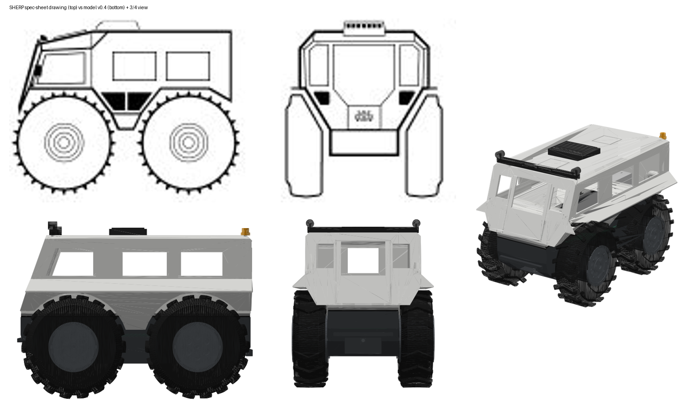
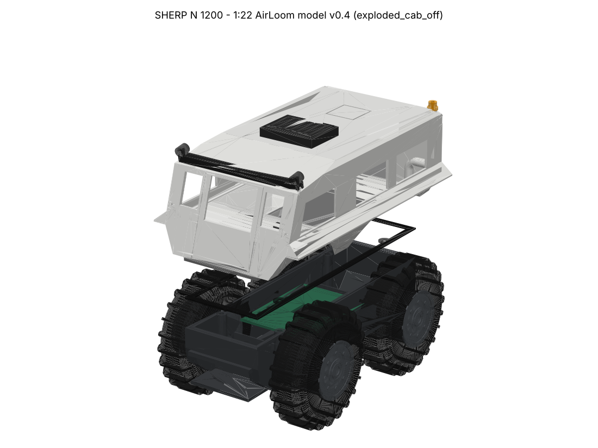
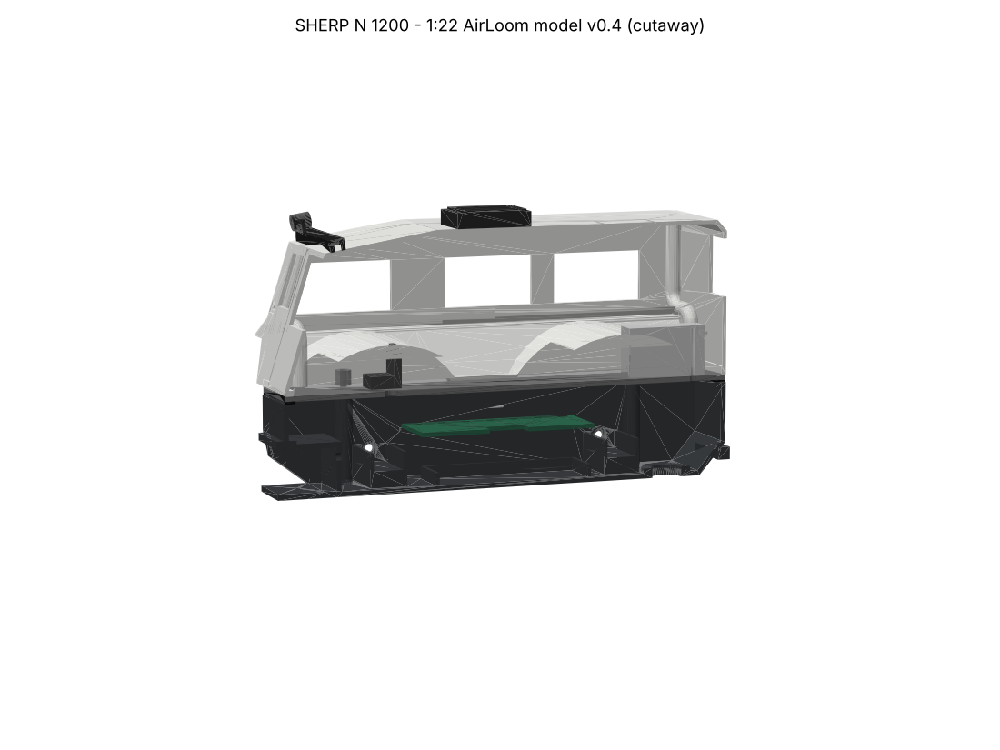

# SHERP N 1200 – 1:22 AirLoom model (v0.4: display + outdoor, floating RC)

A 3D-printable SHERP N 1200 built to demonstrate AirLoom. One hull works two
ways:
- **Display:** lights, winch and fridge light only.
- **RC:** 4-wheel skid steer like the real vehicle. It drives outside and
  floats, paddling with its tyre lugs.

The cab lifts off; the lower hull is sealed.


**Checked against the SHERP spec-sheet drawing:**


| | |
|---|---|
|  |  |
|  |  |

## Latest tweaks
- **Roof line:** the front quarter of the roof now slopes down ~9° to the
  windscreen, like the real cab. The light bar sits on that slope. The front
  face rake is ~17°, and the side windows sit lower, as in the drawing.
- **The cab now needs a little support:** the Bambu project turns on *tree
  supports, build plate only* for the cab alone (for the sloped roof).
  Nothing else needs support.
- **Tyres:** real SHERP pattern with 24 straight paddle blades and pointed
  shoulder teeth. The wheel disc has concentric rings.
- **Winch:** EY RC 1:24 metal winch on a bumper tray in the bow pocket.

## What's new in v0.4 (body redrawn from the spec-sheet drawing)
- The **wheels now sit in the body**, as on the real vehicle:
  - **deep wheel arches**
  - **flared fender ledges** over the tyres (in the front view the tyres
    tuck underneath them)
  - lower cab sides that angle in to the narrow hull
  - a vent panel that dips between the wheels
  - nose and tail that come down to ~1.5 m
- Cab width corrected to ~2060 mm (82 % of overall width, from the drawing).
- Front door / windscreen face raked back ~20°, with tall corner windows
  either side of the windscreen.
- Track corrected to ~88 mm (real 1900 mm).
- Conduits re-routed: they follow the raked front corners, cross over above
  the fenders, then drop inside the hull walls to the lid. All checked clear.
- Fenders and arches print without supports (cab prints roof-down).

## v0.3 changes (still apply)
- **Body matched to the SHERP spec sheet and photos** (sherpaustralia.com and
  sherpglobal.com):
  - the wide cab sits over the tyres and the narrow hull runs between them
  - near-vertical front door with a framed windscreen
  - square headlights low on the front corner pods, with small pod windows
    above them
  - roof A/C, front light bar with a spotlight on each end, rear work
    lights, beacon
  - front and rear roof hatches, side vent grille, front step and rear tow
    bumper
- **Sealed hull and removable cab.** The cab is glued to a deck lid (its
  floor). The lid seals onto the hull rim with a printed **TPU gasket** and
  **4 × M3 × 40 screws from underneath** (hidden).
- **RC drivetrain:** 4 × N20 metal-gear motors, one per wheel, in cradles
  in the hull. Each shaft has an **O-ring + silicone grease** seal where it
  passes through the wall.
- **Winch:** the EY RC 1:24 metal winch sits in an **open pocket in the bow
  on a bumper tray**, under the front step, like the real one. Only its lead
  goes into the hull, through a glued hole. It isn't waterproof: grease it,
  and rinse it in fresh water after swims (or keep it as a dry-land feature).
- **Float check built into the design script.** Estimated all-up mass is
  **563 g**. Waterline is about **53 mm** above the ground, so the gasket
  sits **~11 mm above water** (about 250 mm on the real vehicle). The
  sealed hull and air-filled TPU tyres provide the buoyancy.
- **Bambu Studio project file** with Bambu's own A1, PLA Basic and
  TPU 95A HF settings, laid out on 3 plates.

## Size (1:22)
| | Real | Model |
|---|---|---|
| Length | 4002 mm | 182 mm body / 187 mm incl. step |
| Width | 2520 mm | 117 mm over tyres, cab 94 mm (114 mm over the fenders) |
| Height | 2825 mm (no A/C) | 128 mm roof / 139 mm with roof gear |
| Wheelbase / track | 2118 / 1900 mm | 96 / 88 mm |
| Tyres | 1800 × 600 mm | 81 × 27 mm |
| Clearance | 600 mm | 27 mm |

## Print files (`3mf/`)
**`SHERP N1200 v0.4 - A1 project (3 plates, PLA + TPU).3mf`**: open it in
Bambu Studio. Printer, process and filaments are already set.

| Plate | Filament | Parts |
|---|---|---|
| 1 Body | PLA (slot 1) | Hull tub (floor down), cab (roof down) |
| 2 Details | PLA (slot 1) | Deck lid, 4 hubs, 4 caps, electronics tray, light bar, A/C, fridge, beacon, 2 seats |
| 3 Tyres + gasket | **TPU 95A HF** (slot 2) | 4 tyres, rim gasket |

`SHERP N1200 v0.4 - ASSEMBLED view only.3mf` is for viewing only. Every
part is also in `stl/`.

**Settings:**
- 0.2 mm layers, no supports.
- **Hull: 5 walls + 5 bottom layers** so it's watertight.
- Everything else: 4 walls, 10 % infill.
- **TPU:** external spool (not the AMS lite), 3 walls, 10 % gyroid. The tyres
  are closed shells, so they trap air and help it float.
- **Waterproofing:** brush a coat of thin epoxy (or XTC-3D) on the inside of
  the hull and test it in the sink *before* fitting the electronics.

## Electronics (RC + lights): AliExpress parts
Prices are what AliExpress showed when I searched (US$), from listings with
high sales and good ratings. Pick the variant shown in **bold**.

| # | Part | Qty | Listing |
|---|---|---|---|
| 1 | ESP32-S3 SuperMini (22.5 × 18 mm, Wi-Fi + BLE) | 1 (+1 spare) | https://www.aliexpress.com/item/1005010376539004.html (~$1.09) |
| 2 | N20 metal-gear motor, **6 V 100 RPM**, 3 mm D shaft, *no* rear shaft | 4 (+1) | https://www.aliexpress.com/item/1005009004059913.html (~$2.62, 10k+ sold) |
| 3 | TB6612FNG dual motor driver (one per side + one for the winch) | **3** | https://www.aliexpress.com/item/1005007791592995.html (~$1.99, 10k+ sold) |
| 4 | **EY RC all-metal winch, 1:24 "Style C"** (38.3 mm wide, ~19 g, 2-wire DC motor, hook + fairlead) | 1 | https://www.aliexpress.com/item/1005012696674898.html (~AU$16, 5★); choose the 1:24 / Style C option |
| 5 | 2S 7.4 V 1000 mAh LiPo (≤ 58 × 34 × 16 mm) | 1 | https://www.aliexpress.com/item/1005010142445384.html (~$4.69) |
| 6 | USB-C 2S **8.4 V** charge module with balance support | 1 | https://www.aliexpress.com/item/1005007170943596.html (~$3.39, 10k+ sold) |
| 7 | Mini560 buck, **5 V** fixed (for the ESP32 and LEDs) | 1 | https://www.aliexpress.com/item/1005012462207466.html (~$1.09) |
| 8 | 12 mm waterproof **self-locking (latching)** push button, high head | 1 | https://www.aliexpress.com/item/1005007168217107.html (10k+ sold) |
| 9 | Pre-wired micro LEDs 0402/0603, 3 V, 30 cm (white, red, orange) | 1 pack each | https://www.aliexpress.com/item/1005008521800163.html (~$2.22, 5k+ sold) |
| 10 | NBR O-rings, **CS 1.5 mm, OD 6 mm** (shaft seals) | 1 pack | https://www.aliexpress.com/item/1005008276266074.html (~$1.61, 5k+ sold) |
| 11 | Silicone / marine grease (for the shaft seals) | 1 | https://www.aliexpress.com/item/1005010116112992.html (~$1.09) |
| 12 | M3 × 40 stainless pan-head screws (lid) | 4 | https://www.aliexpress.com/item/1005007264845313.html |
| 13 | JST-SH 1.0 mm 8-pin plug + socket leads (cab lights unplug from the hull) | 1 pair | https://www.aliexpress.com/item/1005007277314092.html (~$1.09) |
| 14 | 30 AWG silicone wire | 1 | https://www.aliexpress.com/item/1005001626937991.html (~$4.26) |
| 15 | Resistors 1/8 W: 47 Ω (white), 100 Ω (red/orange); 100 k + 47 k (battery sense) | – | |

Display-only build: skip part 2, buy 1 TB6612 (winch only), skip 10–11, and wire the lights and winch
the same way.

## Wiring (ESP32-S3 SuperMini)
```
2S LiPo ── charge module (USB-C, balance) ── IP67 latching button ──┬── TB6612 #1 + #2  VM
                                                                     ├── (TB6612 #3 VM for the winch is fed from the 5 V supply below)
                                                                     └── Mini560 5 V ──► ESP32 5V pin, TB6612 VCC
GPIO1  headlights     2 × white   47 Ω each
GPIO2  tail / BRAKE   2 × red    100 Ω  (dim = tail, bright = brake, automatic)
GPIO3  light bar      3 × white   47 Ω
GPIO4  spotlights     2 × white   47 Ω  (on the light bar ends)
GPIO5  rear work / REVERSE lights 2 × white 47 Ω  (come on automatically in reverse)
GPIO6  fridge         1 × white   47 Ω
GPIO7  battery sense  100 k / 47 k divider from the battery +
GPIO8  winch IN1 + GPIO43 winch IN2 (TB6612 #3: AIN1/AIN2, PWMA=STBY=3V3, VM = the 5 V supply - RC winches run at ~4.8-6 V)
GPIO9  left  motors IN1   GPIO10 left  motors IN2   (TB6612 #1: AIN1=BIN1, AIN2=BIN2, PWMA=PWMB=STBY=3V3)
GPIO11 right motors IN1   GPIO12 right motors IN2   (TB6612 #2 the same)
GPIO13 amber beacon   1 × orange 100 Ω
```
The cab lights (everything above the deck) join the hull through the JST-SH
plug, so the cab lifts right off.

## Driving like a real SHERP (firmware plan)
- **Two "levers":** left and right track speed, like the real steering
  levers. It can also mix a single stick into skid steer.
- Turns on the spot, with gentle acceleration and two ranges (crawl / road).
- Brake lights when slowing, reverse lights when backing up, beacon when
  moving (optional).
- **Failsafe:** if the controller goes quiet for 300 ms, it stops. This is
  the same hold-to-run idea as the AirLoom winch.
- **Controllers:** AirLoom phone app (Bluetooth LE) **and** the Hub Super
  Mini touchscreen (ESP-NOW, low latency). Lights and winch use the same
  buttons as a real AirLoom install.

## Hidden wiring routes
| Light | Route |
|---|---|
| Light bar + spotlights | Groove under the bar → roof holes → front corner conduits → across the cab shelf → down the hull spine → lid → hull |
| Headlights | Straight into the front corner conduits |
| Tail, rear work lights, beacon | Rear corner conduits |
| Fridge | Down through the fridge and the lid |
| Spare (dash Hub later) | 5 mm hole in the cab floor between the seats |

All bends are 6 mm radius, so pull the wires through with a guide string.
Seal each lid hole with a dab of silicone once the wires are through.

## Assembly
1. Print, then epoxy-coat the inside of the hull. Leak-test it in the sink.
2. **Motors:** grease an O-ring and seat it in the pocket inside each wheel
   boss. Push the N20 shaft out through it and hot-glue the motor into its
   cradle.
3. **Wheels:** push the tyre over the hub keys, press the hub onto the N20
   D-shaft (a drop of CA), then press in the cap.
4. **Winch:** screw the winch onto the bumper tray (2 × M2) and feed its
   lead through the small hole into the hull, then seal the hole with
   silicone.
5. **Power and electronics:**
   - Fit the latching button through the floor (O-ring and nut from inside).
   - Battery goes in the corral.
   - Electronics tray goes on the ledges, with boards fixed by foam tape and
     zip-ties.
6. **Cab:** fit all the LEDs and pull their wires down the conduits. Glue
   the seats and fridge to the lid. Glue the cab onto the lid, then wire the
   JST plug.
7. **Close up:** put the gasket on the rim, set the cab and lid on top, and
   fit the 4 × M3 × 40 screws from underneath.

## Regenerating
```
pip install manifold3d trimesh numpy matplotlib
python3 generate.py
```
`generate.py` builds the model, checks the float line and writes `stl/`,
`3mf/` and `renders/`. `bambu_3mf.py` writes the Bambu project. It looks for
Bambu's profiles in a checkout of github.com/bambulab/BambuStudio
(`resources/profiles/BBL`, path set by `BBL_PROFILES`).

## Notes and next steps
- **Firmware and app:** next, either as an AirLoom Node build with drive
  added, or as a standalone sketch.
- `test_sketch/` is the old v0.2 display-only tester (ESP32-C3 pinout). It
  will be replaced by the new firmware.
- **Untested:**
  - The 3MF project hasn't been opened in Bambu Studio yet, because it
    can't run in this design environment.
  - The float line is a calculation, so do a bath test before going near a
    pond.
- **Later:** rounded body edges, a hinged front door with ladder, mirrors,
  SHERP the Ark.
