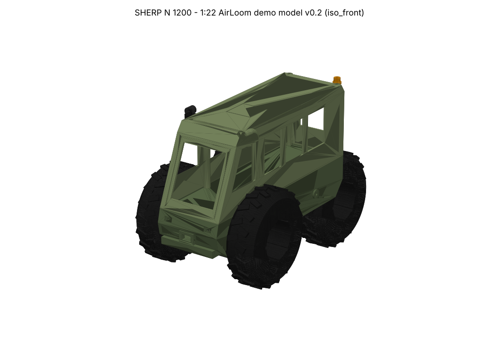
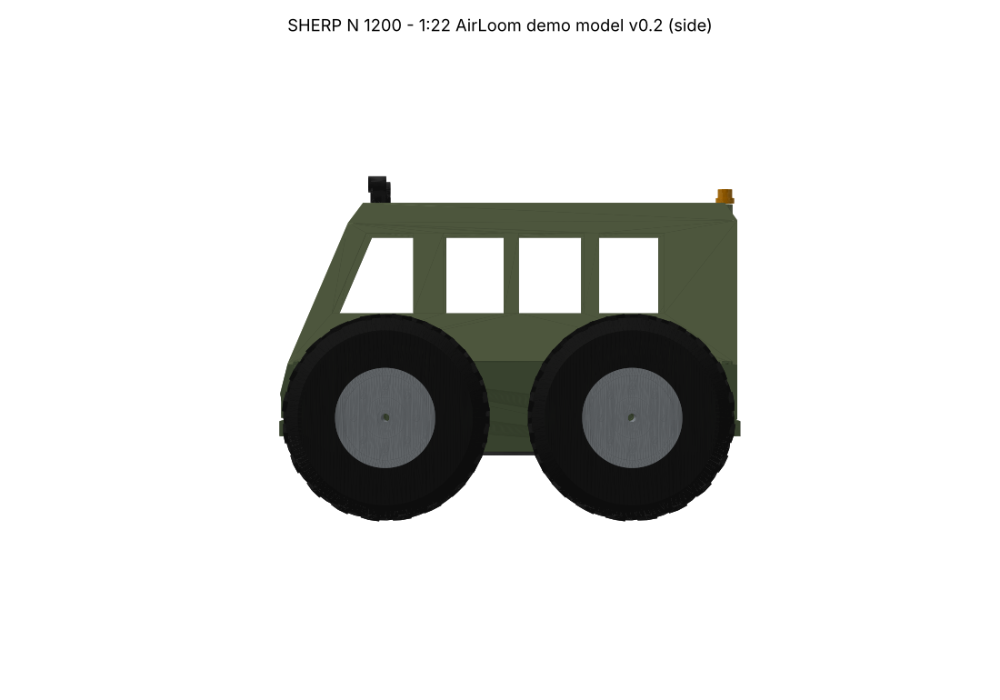
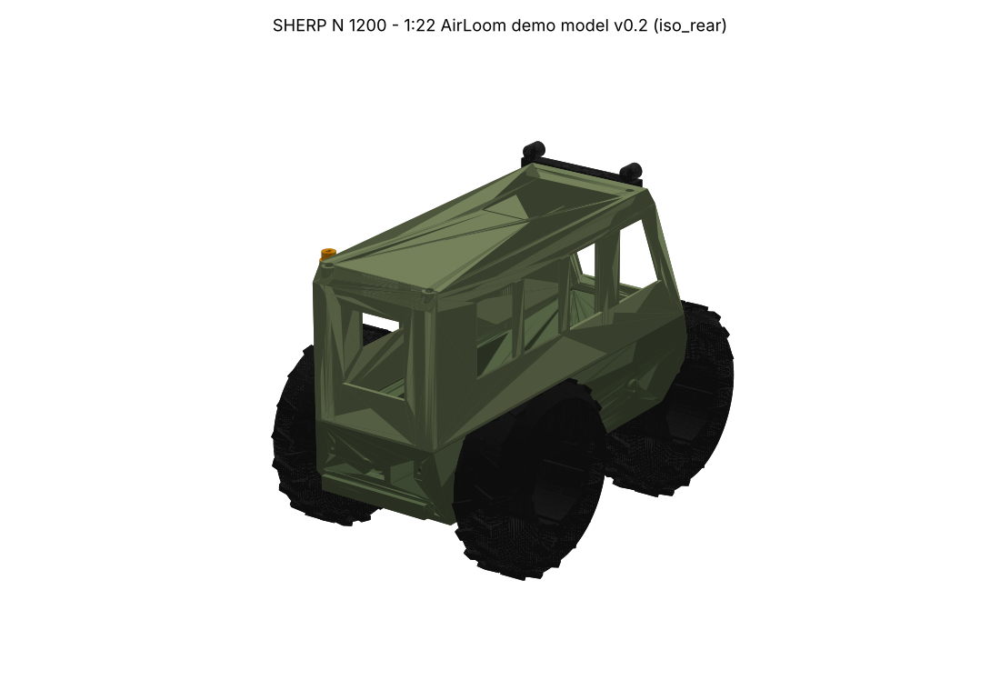
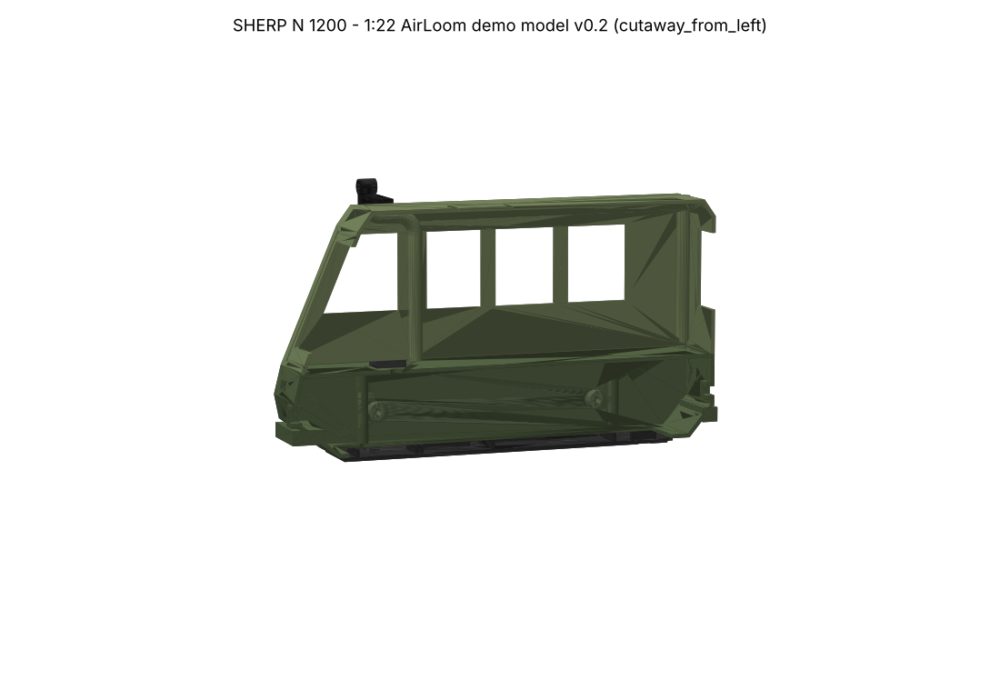
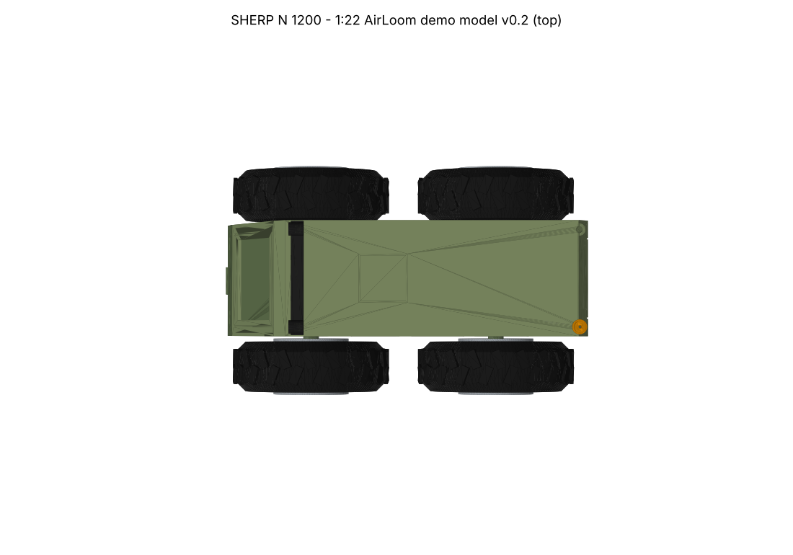

# SHERP N 1200 – 1:22 AirLoom display model (v0.2)

A 3D-printable scale SHERP N 1200 set up as an off-road camper (no awning)
to demonstrate AirLoom. It has wired spots for the headlights, tail lights, a
roof light bar with spotlights, an amber beacon, a fridge light and an RC
winch. The ESP32, battery and wiring are hidden in the hull, behind a
removable belly plate. It's a static display for now, but the layout leaves
room to go RC later.



| | |
|---|---|
|  |  |
|  |  |

## What changed from v0.1
- **Wheels are now 3 parts that click together "Lego-style"**, so there are
  no filament changes mid-print: PLA **hub** with 8 keys, **TPU 95A tyre**
  (pushes on over the keys), PLA **cap** with the wheel-disc detail (push-in
  spigot, held by the wheel screw).
- **Roof lights:** one roof rack holds the **light bar (3 LEDs) plus a
  spotlight on each end**. Its wires drop through two roof holes into
  **conduits under the roof**. Each conduit bends down (radius 5 mm, then
  8 mm) inside a **thickened B-pillar** (12 mm, about 260 mm real) to the
  floor. Duct bore is now 3.4 mm.
- The bumper spotlights have been removed; the spotlights now sit on the roof.
- Print files are now **Bambu-ready 3MF plates** for the A1 (256 × 256),
  grouped so each plate needs only one filament.

## Print plates (`3mf/`)

| File | Filament | Contents |
|---|---|---|
| `SHERP N1200 v0.2 - plate 1 - body (hull + cabin) - A1 PLA.3mf` | PLA, body colour | Hull (deck down) + cabin shell (roof down) |
| `SHERP N1200 v0.2 - plate 2 - details (belly, hubs, caps, lights, interior) - A1 PLA.3mf` | PLA, dark grey/black | Belly plate, 4 hubs, 4 caps, roof light rack, fridge, beacon, 2 seats |
| `SHERP N1200 v0.2 - plate 3 - tyres x4 - A1 TPU 95A.3mf` | **TPU 95A** (e.g. Bambu TPU 95A HF) | 4 tyres |
| `SHERP N1200 v0.2 - ASSEMBLED view only.3mf` | – | For viewing only, don't print |

Open a plate file in Bambu Studio and the parts are already laid out on the
plate. Pick the printer (A1 0.4) and filament, slice and print. Saving it in
Bambu Studio turns it into a full project file. Want the fridge in white or
the beacon in orange? Just move that object onto its own plate.
The individual STL files are also in `stl/`.

**Settings (draft):** 0.2 mm layers, **4 wall loops**, **5–10 % infill**, no
supports (everything is oriented to print without them).
- **TPU tyres:** print from the external spool holder (not through the AMS
  lite). Use the Bambu TPU 95A HF @A1 profile, 3 walls, 10 % gyroid infill.
- **Why TPU 95A:** it grips, it looks and feels like rubber, and it's the
  easiest TPU to print on the A1. TPU 85A is softer but much harder to feed.
  Matte PLA is fine if you just want a quick look.
- **Tyre fit:** if a tyre is too tight on the hub, warm it in hot water for a
  few seconds; if it's loose, add a dab of CA on 2 keys.

## Size and sources
| | Real vehicle | Model (1:22) |
|---|---|---|
| Length | 4002 mm | 184.5 mm |
| Width | 2520 mm | 117.7 mm |
| Height | 2852 mm | 136.5 mm incl. roof lights |
| Wheelbase | 2118 mm | 96.3 mm |
| Tyres | 1800 × 600 mm | 81 × 27 mm |

- SHERP N 1200 spec page: https://sherpglobal.com/en/sherp-n-1200-2/
- Manufacturer spec PDF: https://sherpglobal.com/wp-content/uploads/2020/11/SHERP-N-1200.pdf
- *SHERP-N_catalogue.pdf* (your Google Drive): tyre size, options, doors, hatches
- Design details: [evo India review](https://www.evoindia.com/driven/sherp-n-1200-driven-ultimate-off-roader-that-swims)
  (the nose section hinges down as the entry door, with a fold-out ladder),
  [SHERP USA "Alaskan" build](https://sherpusadealer.com/product/the-alaskan-sherp-n-1200/)
  (front LED bar, side LED bars, flush rear lights, front and rear roof
  hatches), [SHERP NZ](https://sherpnz.co.nz/utv-vehicles/sherp-n-1200/)
- I couldn't view photos from sherpaustralia.com or sherp.global in this
  session because the network blocks both sites. The body shape still comes
  from dimensions and written descriptions, not traced from photos.

## Electronics – parts list (AliExpress)

I couldn't open AliExpress directly, so each part has an **AliExpress search
link** with the exact terms to use, plus a spec to check the listing against.

| # | Part | Qty | Spec to check | AliExpress search |
|---|---|---|---|---|
| 1 | **ESP32-C3 SuperMini** (also sold as "ESP32-C3 Super Mini" / HW-466) | 1 (buy 2–3, they're ~$3) | 22.5 × 18 mm, USB-C, ESP32-C3FH4 | https://www.aliexpress.com/w/wholesale-esp32-c3-supermini.html |
| 2 | **INJORA 360° winch servo, INJS2065-360** (1/24 SCX24 winch) | 1 | 23 × 13 × 25.8 mm, 4.8–8.4 V, 360° continuous rotation | https://www.aliexpress.com/w/wholesale-injora-winch-servo-scx24.html |
| 3 | **Type-C 5 V 2 A charge + boost module, 1S lithium** (LX-LBC3 or "5V2A charge discharge integrated module") | 1 | ≤ 25 × 20 mm, USB-C in, 5 V out, charges while running | https://www.aliexpress.com/w/wholesale-type-c-5v-2a-charge-discharge-module.html |
| 4 | **LiPo 503035 3.7 V 500 mAh, JST-PH 2.0** (603040 ~800 mAh also fits) | 1 | Max 50 × 30 × 8 mm, **with protection board** | https://www.aliexpress.com/w/wholesale-503035-lipo-battery.html |
| 5 | **Pre-wired 0603 micro LED, micro litz wire, 3 V** – white | 1 pack | 0603 (1.6 × 0.8 mm), 20 cm leads. Used for 2 head, 3 bar, 2 spot, 1 fridge | https://www.aliexpress.com/w/wholesale-0603-pre-wired-led-micro-litz.html |
| 6 | Same, **red** | 1 pack | Tail lights (2) | (same search, choose red) |
| 7 | Same, **orange/yellow** for the amber beacon | 1 pack | I couldn't confirm an "amber" 0603; orange looks right | (same search, choose orange) – fallback: [eBay UK seller with orange](https://ebay.com/itm/155149687588) |
| 8 | **SS12D00G3** mini slide switch | 1 (pack) | 8.5 × 3.5 mm body | https://www.aliexpress.com/w/wholesale-ss12d00g3.html |
| 9 | 1/8 W resistor kit (47 Ω, 100 Ω) | 1 | 8 × 47 Ω (white), 3 × 100 Ω (red/amber) | https://www.aliexpress.com/w/wholesale-1-8w-resistor-kit.html |
| 10 | **M3 × 35 pan-head screws** + M3 washers | 4 | Wheels | https://www.aliexpress.com/w/wholesale-m3x35-pan-head-screw.html |
| 11 | **M2 × 6 self-tapping screws** | 4 | Belly plate | https://www.aliexpress.com/w/wholesale-m2x6-self-tapping-screw.html |
| 12 | 30 AWG silicone wire (red/black) | 1 | Extensions inside the bay | https://www.aliexpress.com/w/wholesale-30awg-silicone-wire.html |
| 13 | Winch line + mini hook (1/24 crawler) | 1 | ~0.5 mm braid | https://www.aliexpress.com/w/wholesale-1-24-rc-winch-hook-line.html |
| 14 | Heat-shrink, double-sided foam tape, ≤3 mm cable ties, UV resin (lens domes) | – | | |

References for specs: [ESP32-C3 SuperMini pinout](https://www.espboards.dev/esp32/esp32-c3-super-mini/),
[INJS2065-360 specs](https://nankinhobby.com/products/tow-truck-crane-kit-injs2065-360-winch-servo-for-124-scx24-injs2065-360-194bk),
[LX-LBC3 module](https://scccltd.com/products/lx-lbc3-type-c-2-in-1-charging-discharging-module).

## Wiring / pin map (ESP32-C3 SuperMini)

```
USB-C ──► charge/boost module ──5V──┬──► ESP32-C3 "5V" pin
            │  ▲                    └──► winch servo + (red)
            │  └─ battery via SS12D00 switch
            GND ─────────────────────── ESP32 GND, servo GND (brown), all LED (−)

GPIO ─ resistor ─ LED(+)    (one resistor per LED, LEDs on a channel in parallel)
  GPIO0  headlights    2 × white  47 Ω
  GPIO1  tail lights   2 × red   100 Ω
  GPIO3  light bar     3 × white  47 Ω
  GPIO4  spotlights    2 × white  47 Ω   (roof rack ends)
  GPIO5  fridge        1 × white  47 Ω
  GPIO6  amber beacon  1 × orange 100 Ω  (blinks in firmware)
  GPIO7  winch servo signal (in / out / stop)
  GPIO10 spare         (avoid GPIO2/8/9 – boot strapping / on-board LED)
```

## Hidden wiring routes
| Light | Route into the hull bay |
|---|---|
| Headlights, tail lights | 1.8 mm hole straight through the hull wall |
| Light bar + spotlights | Rack groove → roof hole (each side) → under-roof conduit → B-pillar → floor hole |
| Amber beacon | Rear-left corner duct → floor |
| Spare (camp / rear work light) | Rear-right corner duct → floor |
| Fridge | Hole down through the fridge → floor |
| Spare (dash Hub later) | 5 mm hole in the cab floor between the seats |

**Feeding the conduits:** push a stiff guide (guitar string, 0.3 mm fishing
line or fuse wire) up from the floor hole until it comes out of the roof
hole. Tape the LED wires to it and pull them down. The bends are 5 mm and
8 mm radius, so they slide round easily.

## Assembly
1. **Wheels:** push a tyre over the hub keys until it sits on the hub
   flange. Press the cap's spigot into the hub (visible face out). Fix with
   an M3 × 35 + washer into the hull boss, snug enough to hold but loose
   enough to spin.
2. Fit the head and tail LEDs (wires go inward, then a dot of glue on each
   LED).
3. Fit the light bar and spotlight LEDs into the rack, lay their wires in
   its groove, and pull them down the conduits with the guide string. Do
   the same for the beacon. Glue the rack and the beacon to the roof.
4. Glue the fridge (wire down through the floor) and the seats onto the
   deck. Press the cabin onto the hull (no glue, so it can come off later).
5. **Belly plate:**
   - battery in its cradle (cable tie)
   - ESP32 in its cradle (foam tape, USB-C facing the rear)
   - winch servo between the rails (cable tie)
   - switch in its frame
6. Hot-glue the charge module's USB-C into the rear collar. Wire it up,
   flash `test_sketch/` and check every channel and the winch.
7. Thread the winch line out through the fairlead, then screw the belly
   plate on (4 × M2).

## Regenerating
```
pip install manifold3d trimesh numpy matplotlib
python3 generate.py      # writes stl/, 3mf/ and renders/
```
Everything is parametric (scale, wall, duct bore, LED pocket, tyre fit,
battery size, etc. are at the top of `generate.py`).

## Next (v0.3 ideas)
- Rounded body edges, nose door / ladder detail, side LED bars, mirrors,
  front + rear roof hatches.
- Hollow tyres for a softer "balloon" look.
- Refine the winch bay once the servo is in hand.
- RC version later: the hull bay has room for 2 N20 drive motors and a
  DRV8833 (skid steer like the real thing).
- SHERP the Ark.
